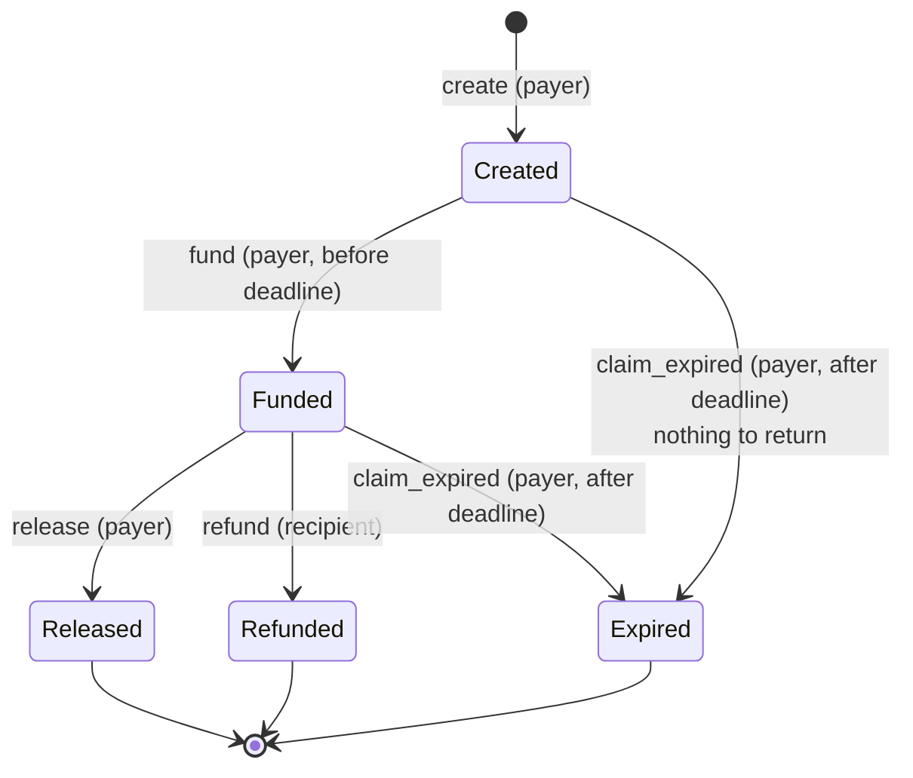
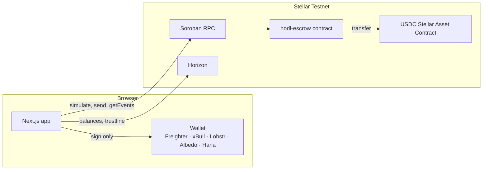

# HodL

**Pay strangers without trusting them.** HodL is a non-custodial USDC escrow on Stellar. The payer locks USDC in a Soroban smart contract until the job is done. Then one of three things happens: the payer releases it, the recipient refunds it, or the deadline sends it back. Nobody else, including HodL, ever holds the money.

| | |
|---|---|
| **Live app** | `https://<your-app>.vercel.app` _(add after deploying)_ |
| **Contract** | [`CCBBKXKT2CMMAU7CUQJBFLIECPJQKN3IGDK6EGOS5PQH56HXF4FNLLDB`](https://stellar.expert/explorer/testnet/contract/CCBBKXKT2CMMAU7CUQJBFLIECPJQKN3IGDK6EGOS5PQH56HXF4FNLLDB) on Stellar Testnet |
| **Verifiable transactions** | [docs/TRANSACTIONS.md](docs/TRANSACTIONS.md): every scenario, every hash |
| **Docs** | [Architecture](docs/ARCHITECTURE.md) · [Contract reference](docs/CONTRACT.md) · [Web app](web/README.md) |
| **Demo video** | _(add link)_ |

Testnet only. The USDC is Circle's free test USDC and has no value.

---

## Contents

- [Why HodL](#why-hodl)
- [How it works](#how-it-works)
- [Features](#features)
- [Architecture](#architecture)
- [The smart contract](#the-smart-contract)
- [Verifiable transactions](#verifiable-transactions)
- [The web app](#the-web-app)
- [Public API](#public-api)
- [Run it locally](#run-it-locally)
- [Environment variables](#environment-variables)
- [Testing](#testing)
- [Deploying](#deploying)
- [Repository layout](#repository-layout)
- [Security model](#security-model)
- [Known limits and roadmap](#known-limits-and-roadmap)

---

## Why HodL

Every online deal between people who just met starts with someone going first:

- **Pay first**, and hope the work shows up.
- **Deliver first**, and hope the money does.
- **Use a middleman**, and pay them to sit on your money for days.

HodL swaps hope for a contract. The money waits in a public smart contract with rules both sides can read. It works for freelance gigs, P2P trades, online sales and bounties: any deal where neither side wants to go first.

## How it works

1. **Agree on the terms.** The payer sets the amount, the recipient and a deadline, and writes down what was agreed. The terms are stored on-chain, and neither side can edit them.
2. **Lock the money.** One wallet signature moves the USDC from the payer into the contract. The recipient can see it's really there before starting work.
3. **Settle it.** There are three possible endings, and each one is final:

| Outcome | Who acts | Where the money goes |
|---|---|---|
| **Released** | The payer, any time, once the work is done | To the recipient |
| **Refunded** | The recipient, any time, if the deal falls through | Back to the payer |
| **Returned** | The payer, after the deadline, if nothing was released | Back to the payer |



Status only moves forward, and every function checks it first. That single check is what stops a release or refund from happening twice.

Past its deadline, a funded escrow stays stored as `Funded` until someone acts, and reads report it as `Expired`. So nothing needs a cron job, and the payer can still choose to pay after all.

## Features

**Contract**
- Non-custodial. Funds only ever go to the escrow's own payer or recipient, and no function takes a destination address.
- Create and fund in a single signature (`create_and_fund`), or save first and fund later.
- Terms (title, plus up to 500 bytes of details) live on-chain, so no database is needed.
- Per-user index lists, so "show me my escrows" is a single read.
- Every state change emits an event with topics `("hodl", action, id)`, which gives the history with transaction hashes.
- A token allowlist (USDC), so a fake token can't fake a funded escrow.
- UUPS-style upgrades with a permanent `lock_upgrades` and a two-step admin handover.
- 35 unit tests, plus a Testnet end-to-end proof run with real test USDC.

**Web app**
- Landing, overview, new escrow, escrow detail, wallet setup, activity and a reviewers' page.
- The detail page adapts to who's looking: payer, recipient or stranger, across every status.
- A wallet setup checklist that runs and fixes itself: Testnet check, Friendbot XLM, USDC trustline, faucet.
- Every transaction shows four steps (checking, sign in wallet, submitting, confirming) and ends with its hash on Stellar Expert.
- Contract errors appear before your wallet opens, in plain words ("Already settled", "Not enough USDC").
- Motion with a purpose: the padlock snaps shut when money locks, amounts count, receipts slide in. It respects reduced-motion settings.
- Responsive down to phones, with a sticky action bar for the one main action.
- Shareable escrow links with a share card for WhatsApp and X.
- Wallets: Freighter, xBull, Lobstr, Albedo and Hana, through Stellar Wallets Kit.

## Architecture

There's one Soroban contract and one Next.js app. **No backend server and no database.** The contract is the database, the history comes from contract events, and "expired" is worked out when the escrow is read.



- **Reads** (`get_escrow`, `get_user_escrows`, …) run as free simulations. They need no signature and cost no fee.
- **Writes** are simulated first, so contract errors show before the wallet opens. The wallet signs, the app submits, then it polls until the transaction is confirmed.
- **The app never holds a key.** If the website went offline, anyone could still call the contract from the Stellar CLI or Stellar Lab.
- **The only server code** is a few stateless, keyless Next.js route handlers: a public read API, Friendbot funding and share cards. The app itself reads the chain directly.

The full design rationale is in [docs/ARCHITECTURE.md](docs/ARCHITECTURE.md).

## The smart contract

`contracts/hodl-escrow` uses Rust and soroban-sdk 29. The full reference, with every function, error, event and storage key, is in [docs/CONTRACT.md](docs/CONTRACT.md).

| Function | Signer | Allowed when | Effect |
|---|---|---|---|
| `create(payer, recipient, token, amount, deadline, title, terms)` | payer | valid inputs | New escrow, `Created` |
| `fund(id)` | payer | `Created`, before deadline | USDC payer → contract, `Funded` |
| `create_and_fund(...)` | payer | valid inputs | Both of the above, one signature |
| `release(id)` | payer | `Funded` | USDC contract → recipient, `Released` |
| `refund(id)` | recipient | `Funded` | USDC contract → payer, `Refunded` |
| `claim_expired(id)` | payer | `Created`/`Funded`, after deadline | Locked USDC → payer, `Expired` |
| `get_escrow(id)` / `get_escrows(ids)` | anyone | always | Escrow plus `effective_status` |
| `get_user_escrows(addr)` | anyone | always | `(paying, receiving)` ids |
| `upgrade(hash)` / `lock_upgrades()` | admin | until locked | Swap the code / freeze it forever |
| `propose_admin(addr)` / `accept_admin()` | admin / proposed admin | always | Two-step handover |

**Deployed:** [`CCBBKXKT…NLLDB`](https://stellar.expert/explorer/testnet/contract/CCBBKXKT2CMMAU7CUQJBFLIECPJQKN3IGDK6EGOS5PQH56HXF4FNLLDB), wasm hash `7f4a927b715740f6e44f6827d0d98a277b4bcc8bafc15a1797431d889926135e` (version 1). The build is reproducible: `stellar contract build` on the pinned toolchain gives the same hash.

**Errors** the app maps to plain messages: `NotFound`, `InvalidStatus` (duplicate release or refund), `InvalidAmount`, `SameParty`, `DeadlineInPast`, `DeadlinePassed`, `DeadlineNotReached`, `TokenNotAllowed`, `TitleTooLong`, `TermsTooLong`, `UpgradesLocked`, `NoPendingAdmin`. Unauthorized callers never reach these; `require_auth()` rejects them first.

## Verifiable transactions

[docs/TRANSACTIONS.md](docs/TRANSACTIONS.md) was produced by `scripts/e2e.ts` against the deployed contract, using real Testnet USDC from Circle's faucet. All 19 steps behaved as expected:

| Scenario | What it proves |
|---|---|
| A. Happy release | create_and_fund → release pays the recipient |
| B. Recipient refund | the recipient can send it back |
| C. Expiry | an early claim is rejected; after the deadline the payer takes it back |
| D. Two-step create | create → fund → release |
| E. Unauthorized | stranger release, recipient release and payer refund are all **rejected on-chain** |
| F. Duplicates | a second release, refund or fund is **rejected on-chain** with `InvalidStatus` |

Rejections in E and F aren't only simulated. They're submitted on-chain anyway, so each failed transaction can be opened on Stellar Expert. A row only passes if the error the network recorded matches the expected one.

## The web app

`web/` uses Next.js 16 (App Router, Cache Components), React 19, Tailwind CSS 4, motion, TanStack Query, React Hook Form with Zod, `@stellar/stellar-sdk` 17 and Stellar Wallets Kit 2.

| Route | What it is |
|---|---|
| `/` | Landing |
| `/dashboard` | Overview: what's locked, what's waiting on you, all escrows with filters |
| `/escrow/new` | Create & lock, with a live summary and a recipient trustline check |
| `/escrow/[id]` | One escrow: status, parties, actions for your role, receipts. Shareable |
| `/setup` | Wallet readiness checklist |
| `/activity` | Every transaction on your escrows |
| `/how-it-works` | For reviewers: state machine, functions, live contract facts, API |

**Design: "Vault, after dark".** The look is calm and exact, more like a bank's vault than a crypto dashboard. A near-black ground, one mint accent that means "money that's safe", Instrument Serif for amounts and headlines, Geist for everything you read, and Geist Mono for addresses and hashes. Each status gets one colour: grey not funded, mint locked, sky released, lilac refunded, coral returned.

## Public API

These routes are read-only, keyless and CORS-open, with JSON cached for about 10 seconds. The app doesn't depend on them; they're for bots, link previews and integrations.

| Route | Returns |
|---|---|
| `GET /api/escrow/:id` | `{ escrow, phase }` |
| `GET /api/escrow/:id/events` | `{ events, truncated }`: receipts with transaction hashes |
| `GET /api/escrows?ids=1,2,3` | `{ escrows }` (up to 100 ids; unknown ids are skipped) |
| `GET /api/users/:address/escrows` | `{ paying, receiving }`; add `?expand=1` for escrows, `?activity=1` for receipts |
| `GET /api/stats` | Contract id, escrow count, version, upgrade lock, admin |
| `GET /api/health` | Soroban RPC and Horizon status |
| `POST /api/friendbot` `{ address }` | Funds a Testnet account with XLM |

```bash
curl https://<your-app>.vercel.app/api/escrow/1
```

## Run it locally

### Prerequisites

| Tool | For | Install |
|---|---|---|
| Node.js 22.18+ (24 recommended) and pnpm | Web app, scripts | [nodejs.org](https://nodejs.org), `npm i -g pnpm` |
| Rust (toolchain pinned in `rust-toolchain.toml`) | Contract | [rustup.rs](https://rustup.rs) |
| Stellar CLI 25.2+ | Building and deploying the contract | `brew install stellar-cli` |
| A Stellar wallet set to **Testnet** | Using the app | [Freighter](https://freighter.app) |

### Just the app (against the live contract)

```bash
cd web
pnpm install
pnpm dev            # http://localhost:3000
```

No `.env` is needed: the app defaults to the deployed Testnet contract. Then:

1. Install Freighter and switch it to **Testnet**.
2. Open **Wallet setup**: connect, click **Fund with Friendbot**, click **Add USDC to my wallet**.
3. Get test USDC from [faucet.circle.com](https://faucet.circle.com), choosing Stellar Testnet.
4. Go to **New escrow** and lock some USDC. Open the escrow link in another browser with the recipient's wallet to see their side.

### The contract

```bash
cargo test                                   # 35 unit tests
cargo clippy --all-targets -- -D warnings
stellar contract build --package hodl-escrow # target/wasm32v1-none/release/hodl_escrow.wasm
```

soroban-sdk 28+ requires `stellar contract build` for wasm, because it strips unused spec entries. A plain `cargo build --target wasm32v1-none` fails by design.

### Deploy your own contract

```bash
scripts/deploy.sh
```

This creates and funds a `deployer` identity, deploys with constructor args (admin, USDC), checks that USDC is allowlisted, writes every public value to `deployments/testnet.env`, and regenerates the TypeScript bindings. Copy those values into `web/.env.local` (or Vercel) to point the app at it.

### Upgrade the deployed contract

```bash
scripts/upgrade.sh
```

This checks that you're the admin and that upgrades aren't locked, then builds, uploads, calls `upgrade`, and prints the version before and after. The address, storage and locked funds stay the same.

## Environment variables

All of these are public. The defaults in `web/lib/config.ts` point at the live contract, so they're only needed to override. Next.js inlines `NEXT_PUBLIC_*` at build time, so redeploy after changing one.

| Variable | Default |
|---|---|
| `NEXT_PUBLIC_STELLAR_NETWORK` | `testnet` |
| `NEXT_PUBLIC_NETWORK_PASSPHRASE` | `Test SDF Network ; September 2015` |
| `NEXT_PUBLIC_RPC_URL` | `https://soroban-testnet.stellar.org` |
| `NEXT_PUBLIC_HORIZON_URL` | `https://horizon-testnet.stellar.org` |
| `NEXT_PUBLIC_HODL_CONTRACT_ID` | `CCBBKXKT2CMMAU7CUQJBFLIECPJQKN3IGDK6EGOS5PQH56HXF4FNLLDB` |
| `NEXT_PUBLIC_USDC_SAC_ID` | `CBIELTK6YBZJU5UP2WWQEUCYKLPU6AUNZ2BQ4WWFEIE3USCIHMXQDAMA` |
| `NEXT_PUBLIC_USDC_ISSUER` | `GBBD47IF6LWK7P7MDEVSCWR7DPUWV3NY3DTQEVFL4NAT4AQH3ZLLFLA5` (Circle Testnet USDC) |
| `NEXT_PUBLIC_EXPLORER_URL` | `https://stellar.expert/explorer/testnet` |
| `NEXT_PUBLIC_SITE_URL` | Vercel production domain, or `http://localhost:3000` (used for share cards) |
| `NEXT_PUBLIC_REPO_URL` | Link target for "GitHub" in the footer |

`scripts/.env` holds Testnet secret keys for the e2e scripts. It's git-ignored and never belongs on Vercel.

## Testing

There are three layers, and each proves something different.

| Layer | Command | What it proves |
|---|---|---|
| **Contract unit tests** | `cargo test` | 35 tests of the rules: happy paths, deadline boundaries, exact length caps, who must sign (auth trees), duplicate protection, atomic rollback, isolation between escrows, event shapes, TTL, and upgrades keeping storage and funds |
| **Testnet proof** | `cd scripts && npm install && node e2e.ts` | The deployed contract on the real network, with real test USDC → [TRANSACTIONS.md](docs/TRANSACTIONS.md) |
| **UI end-to-end** | `cd web && pnpm dev`, then `pnpm e2e` | The whole app in Chrome against the live contract, below |

The UI suite runs 15 steps on two brand-new wallets each time:
- onboarding through Wallet setup;
- form validation and a wallet rejection;
- release, refund (save first, lock later) and expiry (deadline wait, then take back);
- a stranger's read-only view;
- the dashboard and activity pages;
- locking and releasing from a phone's sticky action bar;
- disconnecting.

It fails on any browser console error. A small stand-in for the Freighter extension answers Freighter's own message protocol and signs in the test process, so the app's real wallet code runs and no secret enters the page.

CI (`.github/workflows/ci.yml`) runs contract fmt, clippy and tests, a type-check of the scripts, and the web app's lint and build on every push and pull request.

## Deploying

**Contract:** `scripts/deploy.sh` (see above).

**Web app on Vercel:**
1. Import the GitHub repo in Vercel.
2. Set **Root Directory** to `web`. Keep the Next.js preset and default commands.
3. Optionally add the [environment variables](#environment-variables).
4. Deploy. Every push to `main` ships to production, and pull requests get preview URLs.

If the install step rejects the pnpm version, add `ENABLE_EXPERIMENTAL_COREPACK=1` so Vercel uses the pnpm pinned in `web/package.json`.

**After a Testnet reset** (Testnet is wiped periodically):
1. Run `scripts/deploy.sh` to get the new contract id.
2. Update `NEXT_PUBLIC_HODL_CONTRACT_ID` in Vercel and redeploy.
3. Re-run `scripts/e2e.ts` to regenerate `docs/TRANSACTIONS.md`.
4. Update the contract address in this README.

## Repository layout

```
.
├── contracts/
│   ├── hodl-escrow/            # the escrow contract
│   │   ├── src/                # lib.rs, types.rs, storage.rs, events.rs, errors.rs, test.rs
│   │   └── testdata/           # wasm of the upgrade fixture, used by tests
│   └── upgrade-fixture/        # test-only "v2" for the upgrade tests
├── scripts/
│   ├── deploy.sh               # deploy to Testnet, write deployments/testnet.env
│   ├── upgrade.sh              # upgrade in place (admin)
│   ├── bindings.sh             # regenerate web/contract
│   └── e2e.ts                  # Testnet proof → docs/TRANSACTIONS.md
├── deployments/testnet.env     # public values of the live deployment
├── docs/
│   ├── ARCHITECTURE.md         # design and build plan
│   ├── CONTRACT.md             # contract reference
│   └── TRANSACTIONS.md         # verifiable hashes
├── web/                        # Next.js app (Vercel root directory)
│   ├── app/                    # routes, API route handlers, share card
│   ├── components/             # ui/, escrow/, wallet/, tx/, layout/, landing/
│   ├── lib/                    # hodl/ (reads, events, phase, errors), stellar/ (rpc, tx, horizon), hooks/
│   ├── contract/               # generated TypeScript bindings (for integrators)
│   └── e2e/                    # UI end-to-end suite
└── .github/workflows/ci.yml
```

## Security model

- **One order everywhere:** load, then auth, then status check, then write state, then transfer, then emit the event. State is final before any token moves.
- **Two possible destinations:** funds only go to the escrow's own payer or recipient.
- **One signer per action:** release, fund and claim need the payer; refund needs the recipient. Auth trees are asserted in tests.
- **No admin function touches funds.** The admin can edit the token allowlist and upgrade the code.
- **Upgrades are a trust decision.** While upgrades are enabled, new code could do anything, so the admin key is trusted the way a UUPS proxy owner is. Every upgrade emits an `upgraded` event with the new wasm hash, and `lock_upgrades()` makes the code final forever. Before mainnet: move the admin to a multisig, or lock upgrades once the code is audited.
- **Overflow checks** are on in release builds, and length caps keep storage bounded.

## Known limits and roadmap

- **Testnet only.** It hasn't been audited, so don't use it with real money.
- **No arbiter yet.** "Conditions met" means the payer calls `release`. An optional arbiter who can release or refund is planned for v2.
- **Event history window.** The public RPC keeps events for about a week. Older escrows fall back to the timestamps stored in the contract.
- **Index growth.** Anyone can create an escrow naming any recipient, which adds an id to that recipient's list. It costs the spammer fees and locks nothing of theirs; the app reads ids in batches of 25.
- **Before mainnet:** an audit, the admin on a multisig or upgrades locked, and Circle's mainnet USDC on the allowlist.
